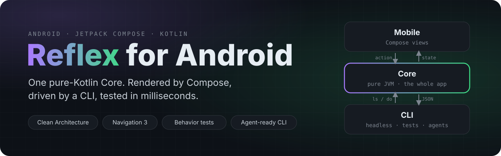
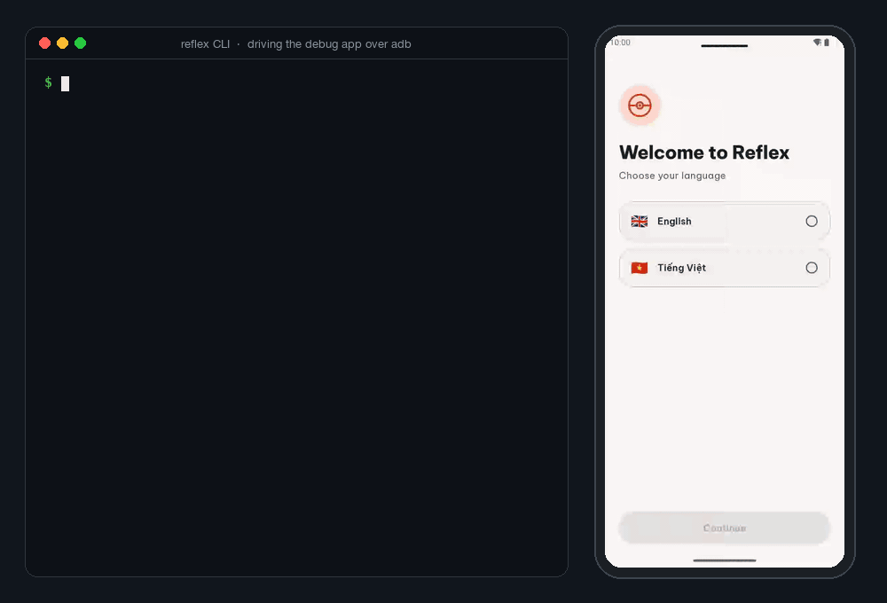
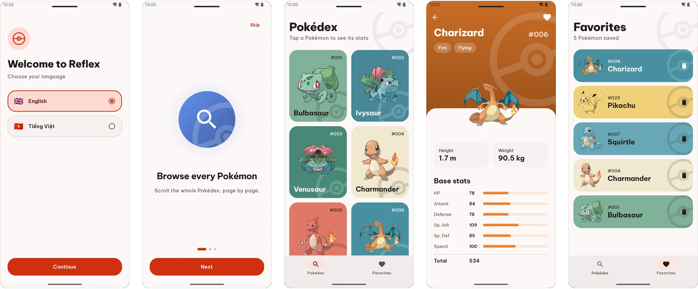
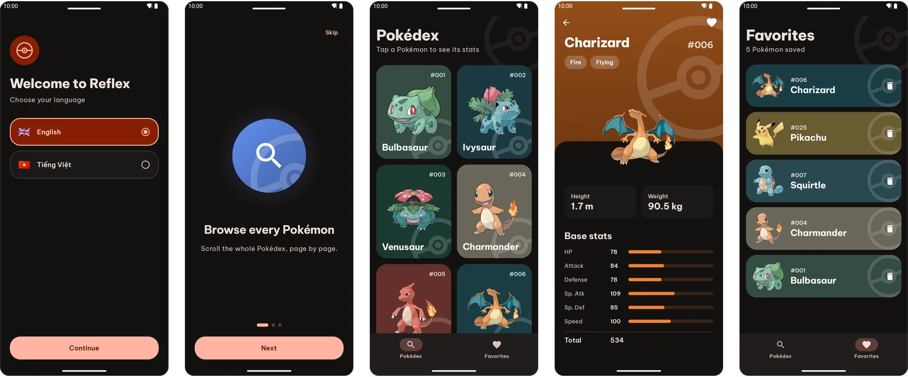
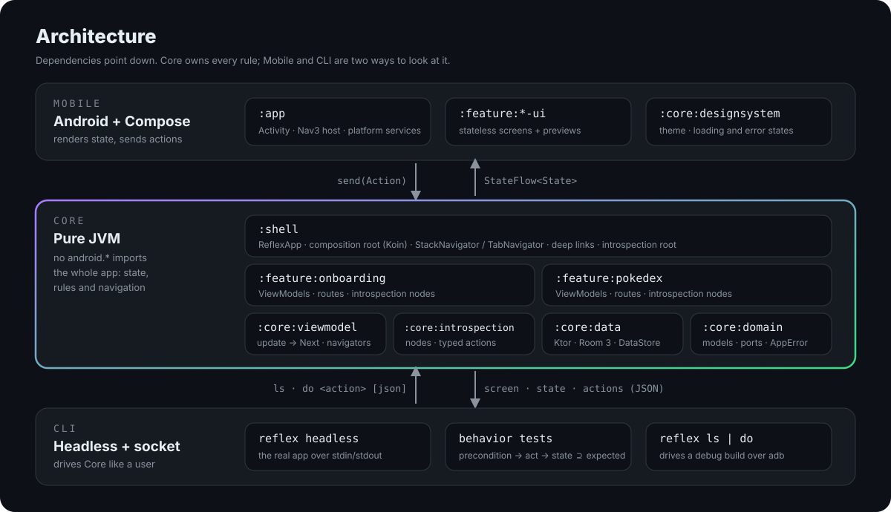
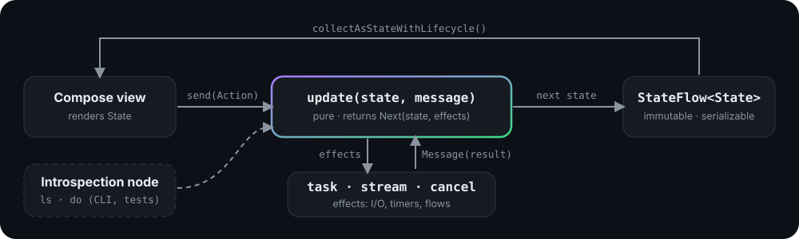

<p align="center">
  
</p>

<p align="center">
  <a href="https://github.com/Nam0101/reflex-android/actions/workflows/ci.yml"></a>
  <a href="LICENSE"></a>
  
  
  
  
</p>

<p align="center">
  <b>An Android starter where the whole app is plain Kotlin.</b><br>
  Compose draws it. A CLI drives it. Tests walk through it like a user, in milliseconds.
</p>

<p align="center">
  <a href="https://github.com/Nam0101/reflex-android/generate"><b>Use this template</b></a> ·
  <a href="#quick-start">Quick start</a> ·
  <a href="#architecture">Architecture</a> ·
  <a href="#behavior-tests">Behavior tests</a> ·
  <a href="AGENTS.md">AGENTS.md</a>
</p>

<p align="center">
  
  <br>
  <sub>Real recording: the <code>reflex</code> CLI drives a debug build on an emulator. Every command is a user action; Compose only re-renders Core state.</sub>
</p>

## Why Reflex

Most Android apps keep their behavior inside Android: ViewModels tied to the framework, navigation inside a
`NavController`, tests that need an emulator. [Reflex](https://shopify.engineering/reflex), an architecture
described by Shopify Engineering, turns that around: the app is a pure-Kotlin **Core** that knows nothing about
Android, and the UI is one of several ways to look at it.

This template applies that idea to a modern Android stack, with Clean Architecture underneath:

- **The app runs without Android.** ViewModels, navigation, repositories, Room and DataStore all run on the plain
  JVM. The same app boots in a terminal in under a second.
- **Every screen can be inspected.** `reflex ls` prints the focused screen, its state as JSON, and the actions a
  user can take, with JSON-schema'd inputs. `reflex do open {"id":25}` performs one. Scripts, tests and coding
  agents use exactly what a user can use, nothing more.
- **Tests read like user stories.** Behavior tests walk real journeys against real Room and DataStore files with
  zero network. All 7 journeys run in about 1.4 s, and a failure prints the whole journey.
- **Clean Architecture without ceremony.** Manual constructor DI, errors as values, a pure
  `update(state, message)` per screen.

## Highlights

| | |
| --- | --- |
| 🧠 **Pure-JVM Core** | Domain, data, ViewModels and navigation in Kotlin/JVM modules: `android.*` does not even compile there. |
| 🧭 **Navigation as state** | `StackNavigator` / `TabNavigator` own the screens; Navigation 3 renders them, predictive back included. |
| 🔍 **Introspection** | Each screen exposes state + typed actions (schema from `KSerializer`); containers lend `goBack` / `selectTab`. |
| 🧪 **Behavior tests** | `precondition → act → state ⊇ expected`, JSON-subset matching, readable failure transcripts. |
| 🤖 **Agent-ready** | [`AGENTS.md`](AGENTS.md) recipe for new screens; agents can operate and verify the real app via the CLI. |
| 🎨 **Compose + Material 3** | Cards colored from each artwork (Palette), type-colored detail, animated stats, dark theme, edge-to-edge, per-app language (English / Tiếng Việt). |
| 💾 **Data** | Ktor + kotlinx.serialization, Room 3 with the bundled SQLite driver, DataStore, `Result<T, AppError>`. |
| ⚡ **Performance** | Baseline + startup profiles, startup and scroll Macrobenchmarks, HTTP disk cache, Compose stability config, R8 with resource shrinking. |
| 🧰 **Tooling** | `build-logic` convention plugins, version catalog, Spotless/ktlint, GitHub Actions, package rename script. |

## Screenshots

<p align="center">
  
  
</p>

The sample app is a [PokeAPI](https://pokeapi.co) Pokédex: language picker → onboarding → paged grid → detail
with stats → favorites stored in Room, plus `reflex://pokemon/{id}` deep links. The first screen is decided by
Core (`ResolveLaunchStep`) behind the system splash screen. Each card takes the dominant color of its artwork
(AndroidX Palette, computed off the main thread and cached); the detail header uses the Pokémon's type color.

## Architecture

<p align="center">
  
</p>

- **Core** holds the whole app. `:shell` is the composition root: it loads the Koin modules (`dataModule` plus one
  per feature), creates a ViewModel per route, owns the navigators and handles deep links.
- **Mobile** is thin. `:app` provides the platform (Room builder, storage directory, locale switching), renders the
  navigator with Navigation 3 and binds each screen to its ViewModel.
- **CLI** is the second front end. It runs the real Core headless with HTTP fixtures, or talks to a debug build
  over an abstract socket forwarded by adb.

### One screen, one loop

<p align="center">
  
</p>

```kotlin
@Introspected // KSP generates the introspection node: one CLI action per Action subclass
class FavoritesViewModel(
  private val favorites: FavoritesRepository,
  private val navigation: PokedexNavigation,
  scope: CoroutineScope,
) : ReflexViewModel<State, Action, Message>(State(), scope) {
  @Serializable
  data class State(val items: List<PokemonSummary> = emptyList(), val isLoading: Boolean = true, val error: AppError? = null)

  sealed interface Action {
    @Serializable data class Open(val id: Int) : Action
    @Serializable data class Remove(val id: Int) : Action
  }

  override fun onStart() = listOf(stream<Message>("favorites", favorites.favorites().map { Message.Loaded(it) }))

  // Pure: the next state plus effects. Suspend work runs in effects and comes back as a Message.
  override fun update(state: State, message: Message): Next<State, Message> = when (message) {
    is Message.ViewAction -> when (val action = message.action) {
      is Action.Open -> state.next(task { navigation.openPokemon(action.id); null })
      is Action.Remove -> state.copy(error = null).next(task { Message.Removed(favorites.remove(action.id)) })
    }
    is Message.Loaded -> message.result.fold(
      success = { state.copy(items = it, isLoading = false, error = null).next() },
      failure = { state.copy(isLoading = false, error = it).next() },
    )
    is Message.Removed -> message.result.fold(success = { state.next() }, failure = { state.copy(error = it).next() })
  }
}
```

The view only renders and forwards; the generated introspection node exposes the same actions to the CLI
(`open`, `remove`), so nothing is written twice:

```kotlin
@Composable
fun FavoritesScreen(viewModel: FavoritesViewModel) {
  val state by viewModel.state.collectAsStateWithLifecycle()
  FavoritesContent(state, viewModel::send) // stateless, previewable
}
```

## Behavior tests

Grey-box journeys in [`cli/src/test`](cli/src/test/kotlin/androidshowcase/reflex/cli/behavior) drive the headless
app through the same protocol as the CLI:

```kotlin
@Test
fun `favorites survive a relaunch and can be removed from the list`() {
  onboard()
  app.act("open", """{"id":1}""", expect = "PokemonDetail", state = """{"isLoading":false}""")
  app.act("toggleFavorite", state = """{"isFavorite":true}""")

  session.relaunch()
  app.precondition("Pokedex", """{"isLoading":false}""")
  app.act("selectTab", """{"tab":"Favorites"}""", expect = "Favorites", state = """{"items":[{"name":"bulbasaur"}]}""")
  app.act("remove", """{"id":1}""", state = """{"items":[]}""")
}
```

State is matched as a JSON subset and awaited until it holds. `act` fails when the app ignores the action;
`ignored` and `refused` assert the two ways an action can go nowhere. Any HTTP request without a fixture fails the
test, time only moves with `session.clock.advanceDays(n)`, and a fixture can `failOnce` or `delay`.
Break the "remove" behavior and the test tells you exactly where the journey went wrong:

```text
AssertionFailedError: Step 9 failed: act remove {"id":1}
  expected screen Favorites with state ⊇ {"items":[]}
  observed: Favorites {"items":[{"id":1,"name":"bulbasaur",...}],"isLoading":false,"error":null}
  actions:  [open, remove, selectTab, openDeepLink]
  journey:
    1. precondition Language {}
    2. act select {"language":"English"}
    3. act continue
    4. act finish
    5. act open {"id":1}
    6. act toggleFavorite
    7. precondition Pokedex {"isLoading":false}
    8. act selectTab {"tab":"Favorites"}
    9. act remove {"id":1}
```

## Quick start

Requirements: Android SDK with platform 37, and a JDK to launch Gradle (the Gradle daemon provisions JDK 21 on its
own).

```bash
# 1. Create your repo from the template (button above), then clone it
git clone https://github.com/<you>/<your-app>.git && cd <your-app>

# 2. Make it yours: moves sources, rewrites packages, namespaces and applicationId
scripts/rename-package.sh com.yourcompany.app

# 3. Build and test
./gradlew test assembleDebug
```

Release builds read `keystore.properties` at the root (git-ignored). Without it they are signed with the debug key,
so they install for testing but cannot be uploaded to Play.

```properties
storeFile=release.jks
storePassword=...
keyAlias=...
keyPassword=...
```

## Drive the app from a terminal

```bash
./gradlew :cli:installDist
cli/build/install/reflex/bin/reflex headless      # the real app on the JVM, HTTP from fixtures
ls
do select {"language":"English"}
do continue
do finish
wait Pokedex {"isLoading":false}
do open {"id":25}
advance 1d                                        # the app's clock; relaunch restarts it on the same disk
```

Every command answers once the app is idle again, so the same lines can be piped in from a script without sleeps.
`do` answers `"ignored":true` when the app accepted the action and did nothing. Fixtures are files named after their
request (`fixtures/pokeapi.co/api/v2/pokemon/25.json`); `reflex headless --record <dir>` saves the missing ones from
the real server.

Against a debug build on a device or emulator:

```bash
cli/build/install/reflex/bin/reflex ls
cli/build/install/reflex/bin/reflex do toggleFavorite
cli/build/install/reflex/bin/reflex wait PokemonDetail '{"isFavorite":true}'
cli/build/install/reflex/bin/reflex screenshot detail.png
cli/build/install/reflex/bin/reflex reset          # clear data, start again, wait for the first screen
```

The CLI runs `adb forward` itself, to the socket `<applicationId>.introspection`: add `--package <applicationId>`
when the installed variant has another id (a flavor or build type suffix). On a device `do` returns once the action
is dispatched; follow it with `wait`. The introspection socket exists only in debug builds.

## Project structure

```text
reflex-android
├── build-logic/            convention plugins: jvm library, android app/library, compose
├── core/
│   ├── domain/             models, AppError, repository ports, use cases            (JVM)
│   ├── data/               Ktor PokeAPI client, Room 3, DataStore, error mapping     (JVM)
│   ├── viewmodel/          ReflexViewModel, effects, Stack/TabNavigator              (JVM)
│   ├── introspection/      nodes, typed actions, JSON schema, NDJSON session         (JVM)
│   ├── introspection-processor/  KSP: generates the node of each @Introspected ViewModel (build time)
│   └── designsystem/       Material 3 theme, Be Vietnam Pro, Poké Ball mark, states  (Android)
├── feature/
│   ├── onboarding/         language + onboarding ViewModels and nodes                (JVM)
│   ├── onboarding-ui/      their Compose screens                                     (Android)
│   ├── pokedex/            Pokédex, detail, favorites ViewModels and nodes           (JVM)
│   └── pokedex-ui/         their Compose screens                                     (Android)
├── shell/                  ReflexApp: composition root, navigation, deep links       (JVM)
├── app/                    Activity, Navigation 3 host, platform, debug socket       (Android)
├── cli/                    headless runner, socket client, fixtures, behavior tests  (JVM)
├── benchmark/              Baseline Profile generator, startup + scroll benchmarks   (Android)
└── scripts/rename-package.sh
```

## Tech stack

| Area | Libraries |
| --- | --- |
| Language & build | Kotlin 2.4.21, Gradle 9.9.0, AGP 9.5.1, KSP 2.3.13, JVM 21, version catalog, type-safe project accessors |
| UI | Compose BOM 2026.09.00 (Material 3), Navigation 3 1.2.1, Lifecycle 2.11.0, Activity Compose 1.13.0, SplashScreen 1.2.0, AppCompat 1.8.0 (per-app locales), Coil 3.6.3, Palette 1.1.0 |
| Data | Ktor 3.6.1 (OkHttp), kotlinx.serialization 1.12.0, Room 3.0.3 + bundled SQLite 2.7.1, DataStore 1.3.0 |
| Async & errors | kotlinx.coroutines 1.11.0, kotlin-result 2.3.1 |
| Dependency injection | Koin 4.2.2 (core, DSL) |
| Testing | JUnit 6.1.3, kotlinx-coroutines-test, Ktor MockEngine, behavior tests over the introspection protocol |
| Performance | Baseline Profile + Macrobenchmark 1.5.0, ProfileInstaller, R8 |
| Quality | Spotless 8.11.0 + ktlint 1.8.0, GitHub Actions, Dependabot |

Min SDK 26, target and compile SDK 37. Versions live in [`gradle/libs.versions.toml`](gradle/libs.versions.toml).

## Adding a feature

1. Route + ViewModel (`State`, `Action`, `Message`, pure `update`) in a JVM feature module.
2. `@Introspected` on the ViewModel: KSP generates its introspection node, one action per `Action` subclass.
3. Register it with `screen<Route> { }` in the feature's Koin module and in the Compose host.
4. A stateless Compose screen in the feature's `-ui` module.
5. A behavior test that walks the journey, with fixtures for its HTTP calls.

[`AGENTS.md`](AGENTS.md) has the full recipe with a check for every step; coding agents follow it as is.

## Design notes

- **Koin at the edge.** `Platform` (what Android provides) → `dataModule` (data) → one module per feature
  (screens), loaded into a `koinApplication` each `ReflexApp` owns. ViewModels keep plain constructors and never
  call Koin; there is no global instance and no generated DI code.
- **JVM, not KMP.** Core modules are Kotlin/JVM so they run headless and in plain JUnit. Moving them to
  Kotlin Multiplatform later is mostly a build change.
- **Process death.** The first screen always comes from launch rules (language chosen? onboarding done?). Once on
  Home, the routes above it and the selected tab are kept in saved instance state (`ReflexApp.saveNavigation`) and
  reopened; screens reload their data instead of restoring their state.
- **Debug-only socket.** Any app on a device can reach an abstract socket, so the introspection server ships only
  in debug builds; release has a no-op twin.

## Credits

- [Reflex](https://shopify.engineering/reflex) by Shopify Engineering, the architecture this template implements.
- [PokeAPI](https://pokeapi.co) and [PokeAPI/sprites](https://github.com/PokeAPI/sprites) for the sample data.
- [Be Vietnam Pro](https://github.com/bettergui/BeVietnamPro) typeface, SIL Open Font License 1.1
  ([`core/designsystem/FONT-LICENSE-OFL.txt`](core/designsystem/FONT-LICENSE-OFL.txt)).
- Built on top of the author's `android-showcase` base project.

Pokémon and Pokémon character names are trademarks of Nintendo, Creatures and Game Freak. This project is not
affiliated with them; the sample uses public PokeAPI data for demonstration only.

## License

[MIT](LICENSE) © 2026 NamNV
